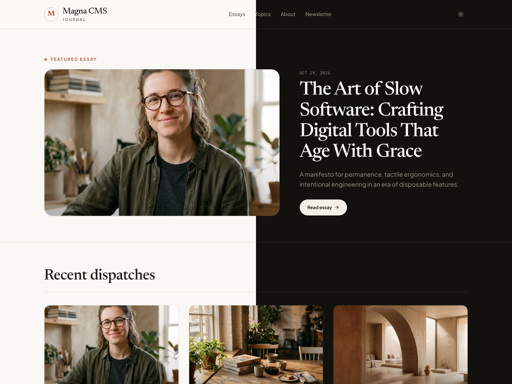
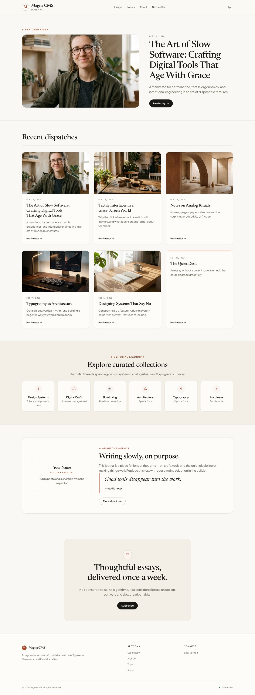
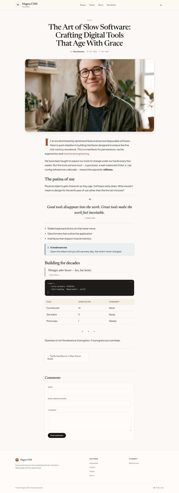
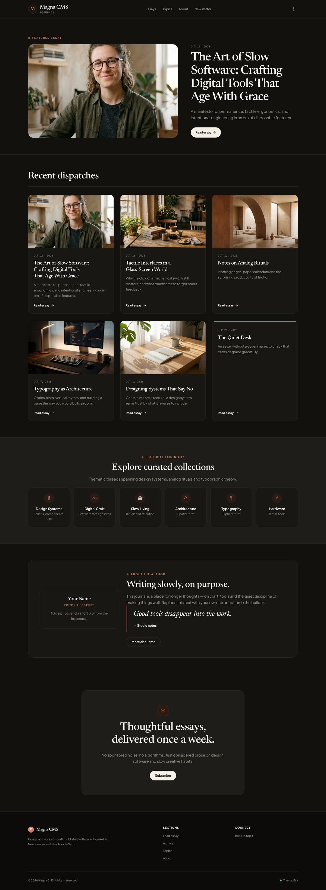
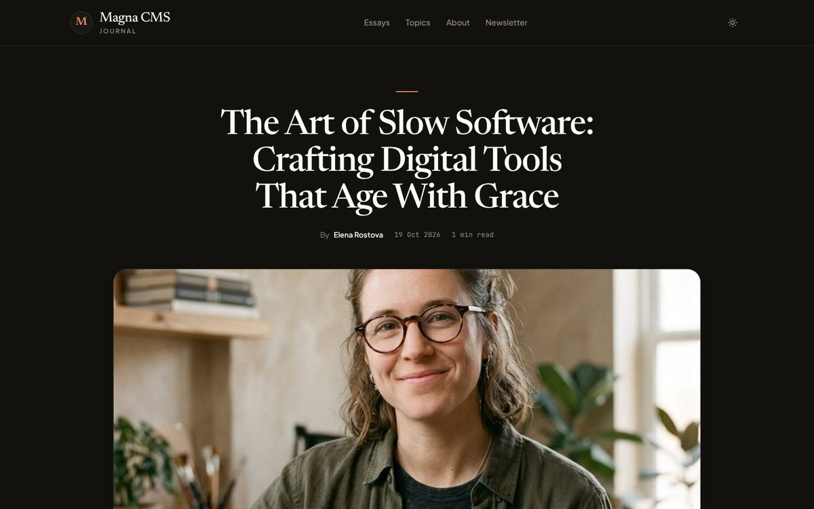
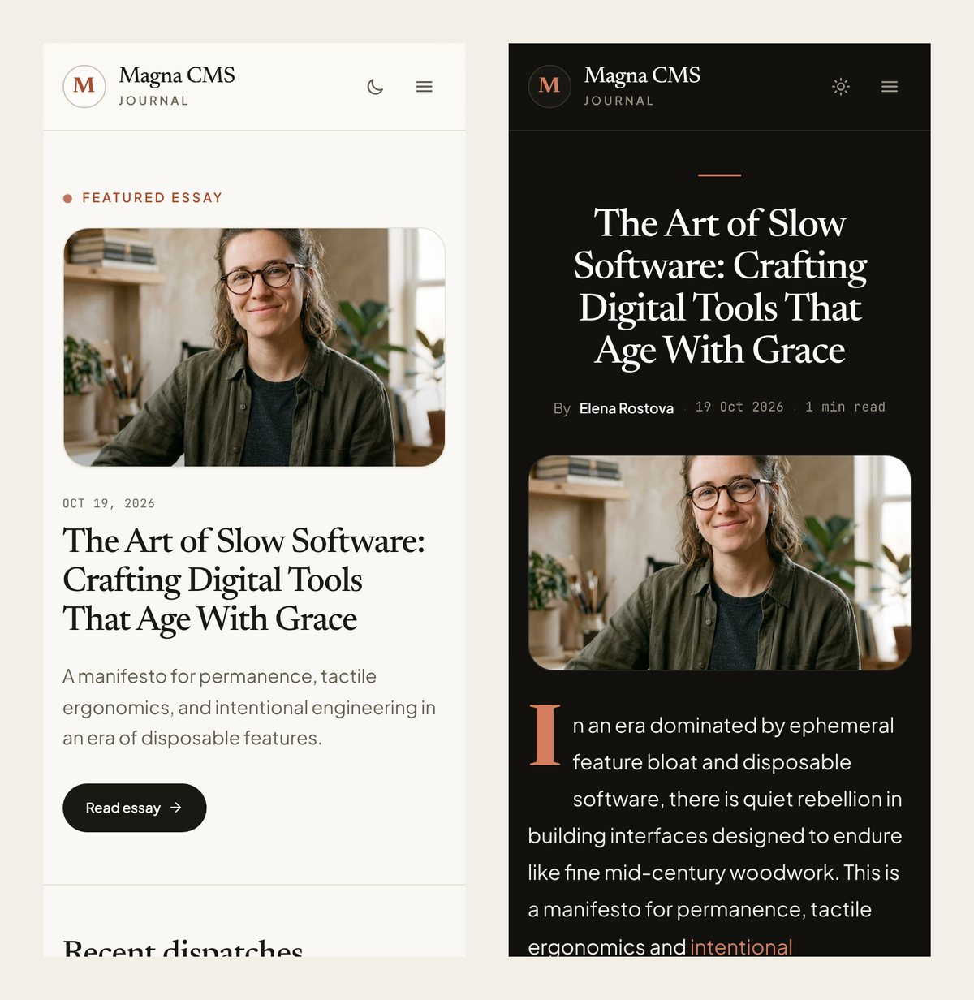
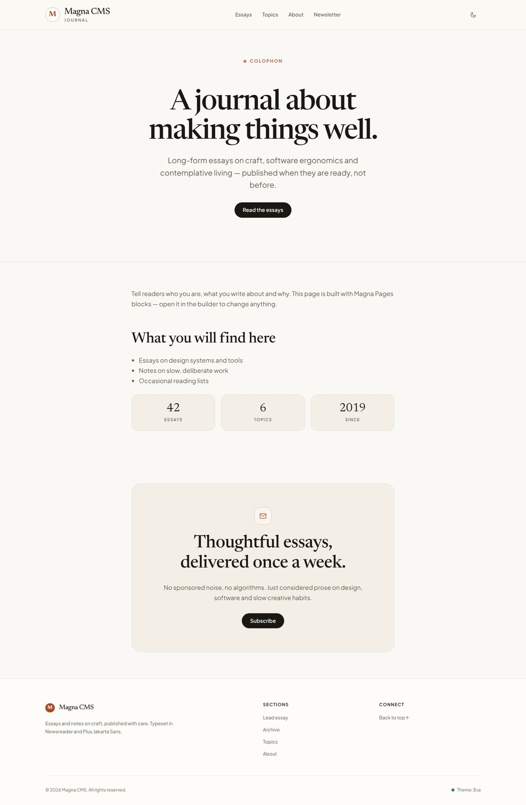
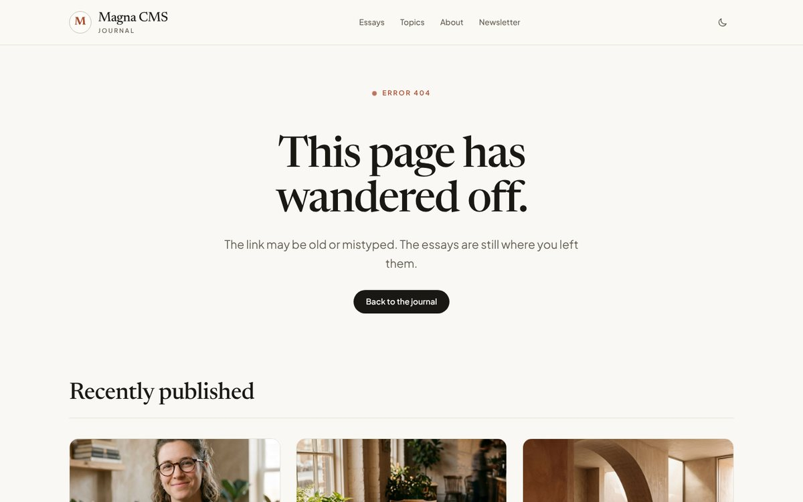
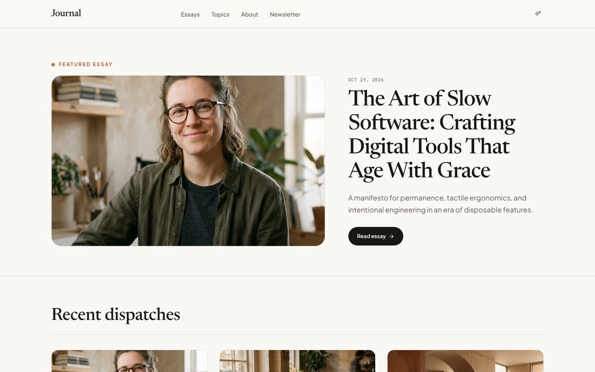

<h1 align="center">Eva</h1>

<p align="center">
  A warm, editorial journal theme for <strong>Magna Pages</strong> and <strong>Magna Blog</strong>.<br>
  Serif headlines, sand and terracotta tones, and a calm reading experience in light and dark.
</p>

<p align="center">
  
  
  
  
  <a href="LICENSE"></a>
</p>

<p align="center">
  
</p>

---

## Screenshots

### Home — lead story, post grid, topics, author and newsletter

<p align="center"></p>

### Reading a post

Centred editorial header, wide featured image, drop cap, pull quotes, callouts, code, tables, previous/next
cards and threaded comments — plus a reading-progress bar along the top.

<p align="center"></p>

### Dark mode

Every colour token ships a dark value. Eva follows the visitor's system setting and remembers their toggle.

<p align="center">
  
  
</p>

### Mobile

<p align="center"></p>

### Also included

<p align="center">
  
  
  
</p>
<p align="center"><sub>About page · 404 page · optional builder-editable header (starter kits)</sub></p>

---

Eva is a **native Magna theme**: plain `theme.json` + `tokens.json` + Blade views, no build step, no
PHP classes, nothing to compile. Every colour, font and width is a design token, so you can retune
the whole theme from **Pages → Design** without touching a file, and every page stays fully
editable in the Magna Pages builder.

## What's in the box

| | |
|---|---|
| **Page shell** | Sticky blurred header with brand monogram, primary menu, light/dark toggle and mobile menu; colophon footer; skip link; back-to-top button. Uses your published header/footer template parts when you have them. |
| **Blog post pages** | Centred editorial header, wide featured image, drop cap, reading-progress bar, styled tags, previous/next cards and threaded comments — all via CSS on Magna Blog's own markup. |
| **Post content** | Styles for every Editor.js block Magna Blog renders: headings with anchor links, quotes, pull quotes, code, verse, tables, callouts, CTAs, columns, galleries, embeds, table of contents, related posts, footnotes and more. |
| **Blog posts block** | Card grid with image zoom, dates and "Read essay" affordance. A block showing **one** post (e.g. the *Featured* feed with limit 1) automatically becomes a large **lead story**. |
| **Every core block** | Hero, CTA (newsletter panel), features (topic cards), team (author card), quote, FAQ, stats, pricing, testimonials, gallery, table, code, nav, search, pagination, popups and more. |
| **Light & dark** | Every colour token ships a dark value. Follows the visitor's system setting, Magna's colour-scheme setting and the scheme-toggle block. |
| **Demo content** | One click on install: home, About and 404 pages, menus, section patterns and six illustrated demo posts — added without touching anything you already have. |

## SEO & performance

Eva is built to score **100 for SEO and 100 for Accessibility** in Google Lighthouse. Measured on the
starter home page, a Blog post, the About page and the 404 page:

| Page | Performance | Accessibility | Best practices | SEO |
|---|---|---|---|---|
| Home | 95 | 100 | 100* | **100** |
| Blog post | 98 | 100 | 100* | **100** |
| About | 98 | 100 | 100* | **100** |
| 404 | 95 | 100 | 100* | **100** |

<sub>* 96 in the isolated test environment, only because Google Fonts could not be reached from it.</sub>

What Eva does for you out of the box:

- `<title>` with the site name, and a **meta description on every page** (the page's own, or a sensible fallback)
- **Canonical URL** (pagination-aware), `robots`, Open Graph and Twitter Card tags — `og:type=article`
  and `og:image` from the featured image on Blog posts
- `hreflang` alternates for multilingual sites
- One `<h1>` per page and a clean heading outline (the eyebrow label is a paragraph, not a heading)
- WCAG AA colour contrast in light **and** dark, visible focus rings, skip link, reduced-motion support
- Crawlable menus and post links with descriptive text; mobile viewport; legible type sizes
- No layout shift from the header; images lazy-load below the fold; all CSS and JS inlined (no extra requests)

> Pair Eva with the **Magna SEO** plugin for per-post SEO titles, descriptions and robots settings —
> Eva prints whatever it provides.

## Requirements

- Magna CMS **1.6.2+**
- Magna Pages **0.3.0-alpha+**
- Magna Blog **1.2.0+** (recommended — Eva works without it, but it is designed for it)

## Install

**From the Magna marketplace** (once listed): **Admin → Themes → Browse marketplace**, install Eva, then
click **Activate**. Skip to step 4.

**Manually:**

1. Download the latest release zip (or clone this repository).
2. Unzip it to `themes/magna-cms/eva/` in your Magna install, so that
   `themes/magna-cms/eva/theme.json` exists.
3. Go to **Admin → Themes** and click **Activate** on Eva.
4. Optional, but recommended — install with **demo content**. Tick **Include demo content** next to
   the install button in **Themes → Browse marketplace**, or press **Import demo content** on Eva's
   card under **Installed**. This adds:

   - **Home**, **About** and **Page not found** pages (set as the home and 404 pages if you have none)
   - the `primary` and `footer` menus and Eva's section patterns
   - **six demo posts** with categories, tags and cover images (needs Magna Blog)

   Only what your site does not have yet is added — an existing page, menu, post or setting is never
   changed. From the command line, `php artisan magna:site:sync themes/magna-cms/eva/starter/eva-site.json`
   applies the same kit as a full sync (it updates existing pages with the same slug).

5. Optional — make the header and footer editable in the builder:

   ```bash
   php artisan magna:site:sync themes/magna-cms/eva/starter/eva-chrome.json
   ```

   Without this, Eva draws its own header and footer from your `primary` and `footer` menus (this
   is the version with the mobile menu). With it, you get `header` / `footer` template parts built
   from Logo, Navigation and Scheme-toggle blocks that you can rearrange freely.

6. Check the theme any time with `php artisan magna:theme:check magna-cms/eva`.

> **Tip:** Mark a post as *Featured* in Magna Blog to put it in the home page's lead story.

## Section classes

Magna Pages lets you give any section a **CSS class** (section settings → *CSS class*). Eva's
vocabulary — combine them freely:

| Class | Effect |
|---|---|
| `eva-band--muted` | Warm tinted background with top and bottom rules |
| `eva-band--panel` | Wraps the section's columns in a rounded card |
| `eva-band--ink` | Inverted dark band (light text) |
| `eva-band--ruled` | Hairline rule under the section |
| `eva-band--rule` | Hairline rule under the content only (inset) |
| `eva-band--narrow` | Constrains the section to reading width |
| `eva-band--center` | Centres text and headings |
| `eva-band--tight` | Halves the vertical padding |
| `eva-band--flush` | Removes the top padding (to sit under the previous band) |

## Little things worth knowing

- **Eyebrow labels:** a Heading block set to **H6** renders as Eva's small uppercase terracotta label
  with a pulsing dot — use it above section titles. It is output as a paragraph, so it never breaks
  the page's heading order.
- **Lead story:** any Blog posts block that shows exactly one post becomes the large featured layout.
- **Newsletter panel:** the CTA block (*Centered* layout) renders as Eva's envelope-badged newsletter band.
- **Topic cards:** the Features block (*Icon grid*) renders as topic cards; the icon field takes any
  character — `§`, `¶`, `#`, `</>`, an emoji.
- **Author card:** the Team block renders as a portrait card.
- **Menus:** the fallback header reads the `primary` menu; the fallback footer reads `footer` (falling
  back to `primary`) and an optional `social` menu.

## Design tokens

All tokens are editable in **Pages → Design** and can be overridden per section.

| Group | Tokens |
|---|---|
| Colours | `bg`, `surface`, `surface-alt`, `chrome`, `text`, `heading`, `muted`, `subtle`, `border`, `border-strong`, `primary`, `primary-strong`, `primary-soft`, `primary-line`, `on-primary`, `ink`, `on-ink`, `code-bg`, `code-text`, `success`, `warning`, `danger`, `info` (all as `--color-*`) |
| Type | `--font-body` (Plus Jakarta Sans), `--font-heading` (Newsreader), `--font-mono` (JetBrains Mono), `--base-size`, `--prose-size`, `--line-height` |
| Layout | `--max-width`, `--content-width`, `--gutter`, `--section-y`, `--header-height` |
| Shape | `--radius-sm`, `--radius-md`, `--radius-lg`, `--radius-pill` |

## Theme structure

```
eva/
├── theme.json                  manifest (magna-cms/eva)
├── composer.json               package metadata ("type": "magna-theme") for Packagist / the marketplace
├── tokens.json                 design tokens with light + dark values
├── screenshot.png
├── starter/
│   ├── eva-site.json           demo content: pages, menus, patterns, posts, home/404
│   └── eva-chrome.json         optional header/footer template parts
└── views/
    ├── system/layout.blade.php the page shell
    ├── partials/
    │   ├── header.blade.php    fallback header
    │   ├── footer.blade.php    fallback footer
    │   ├── styles.blade.php    the stylesheet (inlined)
    │   └── scripts.blade.php   progressive enhancements
    └── blocks/
        ├── blog-posts.blade.php  editorial cards + automatic lead story
        └── heading.blade.php     H6 becomes the eyebrow label
```

`art/` holds the README screenshots and is not used by the theme.

Why is the CSS inlined? Magna doesn't serve files out of theme folders, and the Pages page cache
stores whole HTML documents anyway — inlining keeps Eva self-contained and update-safe.

## Credits

Typefaces: [Newsreader](https://fonts.google.com/specimen/Newsreader),
[Plus Jakarta Sans](https://fonts.google.com/specimen/Plus+Jakarta+Sans) and
[JetBrains Mono](https://fonts.google.com/specimen/JetBrains+Mono), served by Google Fonts.

## License

MIT
